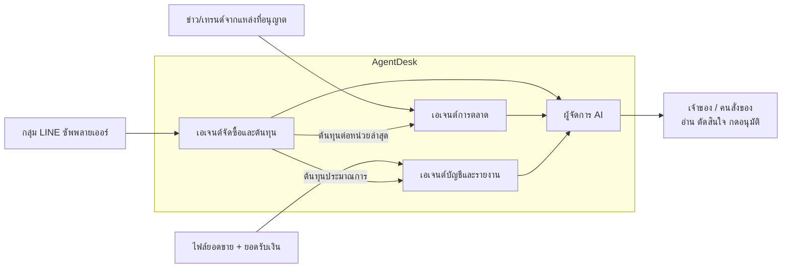

# AgentDesk — AI Agent Workflow

แพลตฟอร์มระบบ AI Automation แบบ "เลือกซื้อเป็นชิ้น" ธุรกิจเปิดใช้เฉพาะเอเจนต์ที่ต้องการ แล้วตั้งค่า "โปรไฟล์ธุรกิจ" (รายการสินค้า หน่วย สูตรต้นทุน เป้ากำไร) ให้เข้ากับธุรกิจนั้น โดยไม่ต้องเขียนโค้ดใหม่

> repo นี้อธิบาย **แนวคิดและขั้นตอนการทำงาน (workflow)** ของเอเจนต์แต่ละตัว พร้อมตัวอย่างธุรกิจ
> ทำขึ้นตอนเตรียมข้อเสนอสำหรับงานแข่งขัน SPU AI Hackathon 2026 (ทีมไม่ได้ผ่านเข้ารอบชิง) แล้วเปิดเป็นสาธารณะไว้ให้คนที่สนใจอ่านและนำไปต่อยอด
> ตัวเลขทุกตัวในตัวอย่างเป็น **ข้อมูลตัวอย่าง** ไม่ใช่ข้อมูลร้านจริง

## ปัญหาที่ตั้งต้น

สมาชิกทีมเคยทำหน้าที่สั่งของในร้านชาบู ร้านมีกลุ่ม LINE กลุ่มเดียวที่ซัพพลายเออร์แจ้งราคาขึ้นลงและรับคำสั่งซื้อ คนสั่งของต้องอ่านแชตเอง ดูของที่เหลือเอง แล้วตัดสินใจเองทุกวัน จึงเสี่ยงสามอย่าง คือซื้อตอนราคาแพง ซื้อเกินจนของเสีย หรือของขาด

ธุรกิจอื่นที่ซื้อของจากผู้ขายหลายเจ้าผ่าน LINE และต้องคิดต้นทุนต่อหน่วยซ้ำทุกวัน เช่น โรงแรม หรือร้านวัสดุ ก็เจอปัญหาแบบเดียวกัน

## ภาพรวมระบบ

| เอเจนต์ | ทำอะไร (สั้นๆ) | รอบการทำงาน | อ่านต่อ |
|---|---|---|---|
| จัดซื้อและต้นทุน | อ่านราคาจากกลุ่ม LINE แล้วแนะนำว่า "ควรซื้อ / ใกล้หมด / รอก่อน" พร้อมบอกต้นทุนต่อหน่วย | ทุกคืน | [docs/01](docs/01-procurement-agent.md) |
| การตลาด | หาข่าวหรือเทรนด์ แล้วร่างโปรโมชันที่ไม่ทำให้ขาดทุน | สัปดาห์ละ 2 ครั้ง | [docs/02](docs/02-marketing-agent.md) |
| บัญชีและรายงาน | เทียบยอดรับเงินกับยอดขาย หาวันที่ยอดไม่ตรง และสรุปรายสัปดาห์ | ทุกวัน / ทุกสัปดาห์ | [docs/03](docs/03-accounting-agent.md) |
| ผู้จัดการ AI | รวมผลจากทุกเอเจนต์เป็นสรุปเดียว | ทุกเช้า | [docs/04](docs/04-manager-agent.md) |

ตัวอย่างธุรกิจ: [docs/05-business-examples.md](docs/05-business-examples.md) · ทีม AI ที่ใช้สร้างโปรเจกต์นี้: [docs/06-build-team.md](docs/06-build-team.md)

## หลักการออกแบบ

1. **คนเป็นผู้ตัดสินใจเสมอ:** ระบบไม่สั่งซื้อ ไม่โพสต์ และไม่ส่งข้อความหาลูกค้าเอง ทุกอย่างจบที่การ์ด "รออนุมัติ"
2. **ตัวเลขคำนวณด้วยโค้ด:** AI (LLM) ใช้แค่อ่านข้อความที่ไม่เป็นรูปแบบ และเรียบเรียงภาษา ไม่ได้ใช้คิดเลข
3. **ข้อความที่ไม่ชัดส่งให้คนตรวจ:** เช่น "นมกล่อง 9 ค่ะ" ที่ไม่มีหน่วย ระบบไม่เดาเอง
4. **ทำงานบนช่องทางที่ลูกค้าใช้อยู่แล้ว (LINE):** ไม่ต้องเปลี่ยนซัพพลายเออร์ และไม่ต้องกรอกข้อมูลซ้ำ
5. **เคารพข้อมูลส่วนบุคคล:** ต้องขอความยินยอมจากสมาชิกในกลุ่มก่อนให้บอทอ่าน (PDPA) และดึงข้อมูลเว็บเฉพาะที่ robots.txt อนุญาต
6. **โปรไฟล์ธุรกิจแทนการเขียนโค้ด:** เพิ่มธุรกิจประเภทใหม่ทำได้ด้วยการเพิ่มไฟล์ตั้งค่า 1 ไฟล์

## สถานะ (ตามจริง)

| ส่วน | สถานะ |
|---|---|
| ต้นแบบแพลตฟอร์ม (FastAPI + SQLite + หน้าเว็บ) | ✓ รันได้ในเครื่อง ทดสอบกับข้อมูลตัวอย่าง 2 โปรไฟล์ (ร้านชาบู, โรงแรมขนาดเล็ก) |
| เอเจนต์จัดซื้อ, การตลาด | ✓ ทำแล้วในต้นแบบ (โหมดกฎ) |
| เอเจนต์บัญชี | ◐ เวอร์ชันเล็ก (นำเข้า CSV กระทบยอด และสรุปรายสัปดาห์) |
| เชื่อม LINE OA จริง (webhook) | ✗ ยังไม่ได้ทำ |
| ใช้ Claude (LLM) จริง | ✗ ยังไม่ได้ทดสอบกับ API key |
| ลูกค้าจริง | ✗ ยังไม่มี |
| ธุรกิจที่ใช้สูตรต้นทุนแบบอื่น (เต็นท์รถ, อสังหาฯ) | ✗ ต้องเพิ่มชนิดสูตรต้นทุนก่อน |

## เทคโนโลยีที่ตั้งใจใช้

LINE Official Account + Messaging API (webhook) · Python FastAPI + scheduler · SQLite (หรือ Google Sheets ให้ลูกค้าดู) · Claude Haiku เป็นหลัก ส่วน Sonnet ใช้เฉพาะงานที่ Haiku มั่นใจต่ำหรืองานสรุปข้ามระบบ

## License

เนื้อหาเอกสารใช้สัญญาอนุญาต [CC BY 4.0](https://creativecommons.org/licenses/by/4.0/) นำไปใช้หรือดัดแปลงได้ โดยต้องให้เครดิต
