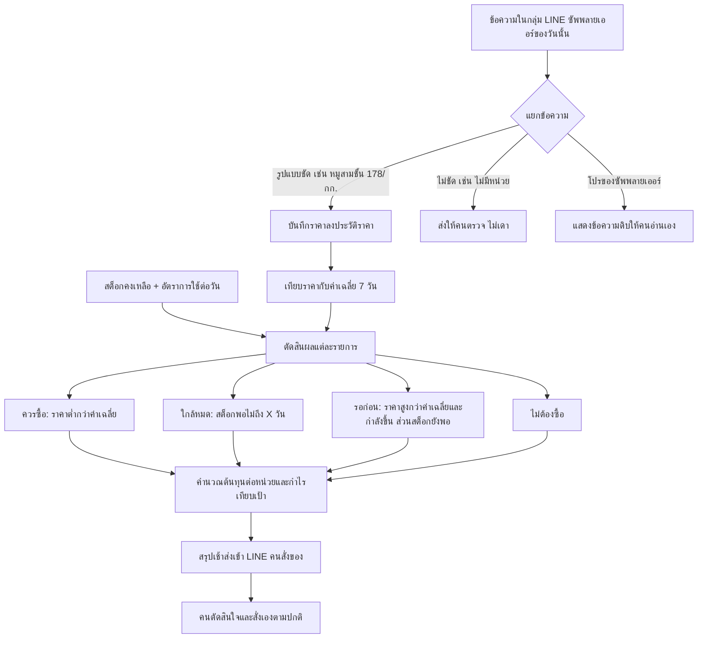

# 01 · เอเจนต์จัดซื้อและต้นทุน (Procurement & Cost Agent)

**หน้าที่:** ช่วยคนสั่งของตัดสินใจทุกเช้าว่าวันนี้ควรซื้ออะไร ซื้อเท่าไร หรือควรรอก่อน และบอกว่าต้นทุนต่อหน่วย (ต่อจาน ต่อหัว หรือต่อห้อง-คืน) เปลี่ยนไปเท่าไร

**รอบการทำงาน:** อัตโนมัติวันละครั้งตอนกลางคืน และส่งสรุปตอนเช้า

## Workflow



## ขั้นตอนละเอียด

1. **รับข้อความ:** ในระบบจริงบอท LINE OA อยู่ในกลุ่มและรับข้อความผ่าน webhook ส่วนในต้นแบบใช้ไฟล์ประวัติแชตที่ส่งออกจาก LINE (.txt)
2. **แยกราคา:** ใช้กฎ (regex) ก่อน ถ้ากฎอ่านไม่ได้ จึงให้ LLM ช่วยอ่าน ถ้า LLM ก็ไม่มั่นใจ ให้ส่งให้คนตรวจ
3. **เก็บประวัติราคา:** แยกตามรายการ ผู้ขาย และวันที่ ข้อมูลส่วนนี้คือ "สินทรัพย์" ที่สะสมทุกวัน
4. **คำนวณ:** ค่าเฉลี่ย 7 วัน, ส่วนต่างเป็น %, จำนวนวันที่สต็อกพอใช้ = สต็อก ÷ อัตราการใช้ต่อวัน และปริมาณที่ควรซื้อ
5. **ต้นทุนต่อหน่วย:** ผลรวมของ (ราคา × ปริมาณที่ใช้ต่อหน่วยขาย) + ต้นทุนคงที่ต่อหน่วย แล้วเทียบกับราคาขายและเป้ากำไร
6. **สรุปเช้า:** ข้อความสั้นที่อ่านจบใน 1 นาที ระบบไม่สั่งซื้อเอง

## ตัวอย่างผลลัพธ์ (ข้อมูลตัวอย่าง: ร้านชาบูบุฟเฟต์)

```
☀ สรุปจัดซื้อ (ข้อมูลตัวอย่าง)
⚠ กุ้ง ใกล้หมด (เหลือ ≈ 0.2 วัน) ควรซื้อ ~9 กก.
✓ ควรซื้อ หมูสามชั้นสไลด์ ~27 กก. วันนี้ 178 บาท ต่ำกว่าค่าเฉลี่ย 7 วัน 4.1%
⏸ รอก่อน เนื้อวัวสไลด์ 360 บาท สูงกว่าค่าเฉลี่ย 6.8% และกำลังขึ้น สต็อกยังพอ ≈ 4.6 วัน
ต้นทุนต่อหัว 104.84 บาท · กำไรขั้นต้น 64.9% (เป้า 60%)
ข้อความที่ต้องตรวจเอง 1 รายการ
ระบบนี้ไม่สั่งซื้อให้ ผู้สั่งของตัดสินใจเอง
```

## ข้อจำกัด

- เอกสาร LINE ยืนยันว่าบอทในกลุ่มได้รับ webhook event แต่ยังไม่ได้ทดสอบว่าได้รับทุกข้อความหรือไม่ และบอทอ่านข้อความก่อนเข้ากลุ่มไม่ได้
- สูตรต้นทุนปัจจุบันเหมาะกับธุรกิจที่ใช้วัตถุดิบหรือวัสดุต่อหน่วยขาย

กลับ: [README](../README.md)
