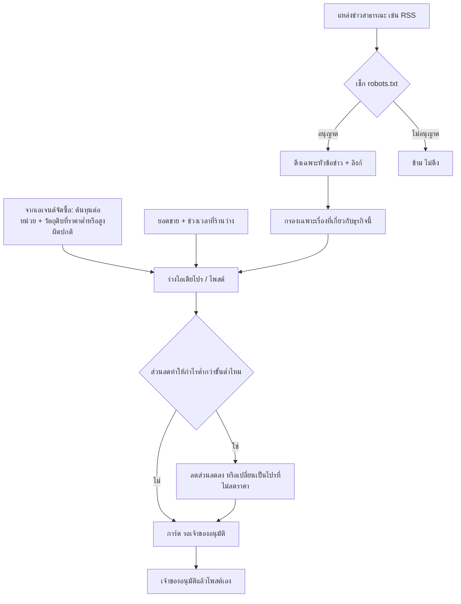

# 02 · เอเจนต์การตลาด (Marketing Agent)

**หน้าที่:** ติดตามว่าตลาดพูดถึงอะไร แล้วร่างไอเดียโปรโมชันหรือโพสต์ โดยใช้ต้นทุนจริงจากเอเจนต์จัดซื้อ จึง **ไม่เสนอโปรที่ทำให้ขาดทุน**

**รอบการทำงาน:** สัปดาห์ละ 2 ครั้ง (ปรับได้)

## Workflow

## ขั้นตอนละเอียด

1. **หาข้อมูล:** ดึงเฉพาะแหล่งที่อนุญาต ไม่ดึง Google News (robots.txt ห้ามบอท) ไม่ดึงโซเชียล และไม่ดึงรีวิว (ข้อกำหนดการใช้งานห้าม)
2. **ผูกกับต้นทุน:** ถ้าวัตถุดิบตัวไหนราคาต่ำกว่าปกติ ให้เสนอเมนูหรือโปรที่ใช้วัตถุดิบนั้น ถ้าตัวไหนแพงขึ้น ให้เลี่ยง
3. **คุมส่วนลดด้วยโค้ด:** % ส่วนลดสูงสุด = ส่วนลดที่ยังทำให้กำไรขั้นต้น ≥ ขั้นต่ำที่ตั้งไว้
4. **ใช้ LLM เรียบเรียง:** ใช้เขียนข้อความโพสต์ (ต้องมี API key) ถ้าไม่มี key จะใช้เทมเพลตแทน
5. **การ์ดรออนุมัติ:** ระบบไม่โพสต์และไม่บรอดแคสต์เอง

## ตัวอย่างผลลัพธ์ (ข้อมูลตัวอย่าง)

| ธุรกิจ | สถานการณ์ | ไอเดียที่ร่าง |
|---|---|---|
| ร้านชาบู | หมูสามชั้นถูกกว่าค่าเฉลี่ย 4% แต่บ่ายวันธรรมดาร้านว่าง | "ชุดหมูจัดเต็มช่วง 14:00–16:00" ส่วนลดถูกจำกัดจนกำไรขั้นต้นไม่ต่ำกว่า 60% |
| ร้านชาบู | กำไรขั้นต้นต่ำกว่าเป้าแล้ว | ไม่เสนอให้ลดราคา แต่เสนอแถมน้ำหรือของหวานต้นทุนต่ำแทน |
| โรงแรมขนาดเล็ก | ราคาไข่ไก่สูงขึ้น 10% | ไม่ใช้อาหารเช้าเป็นจุดขาย แต่เสนอโปรพักต่อคืนที่สองแทน |

กลับ: [README](../README.md)
