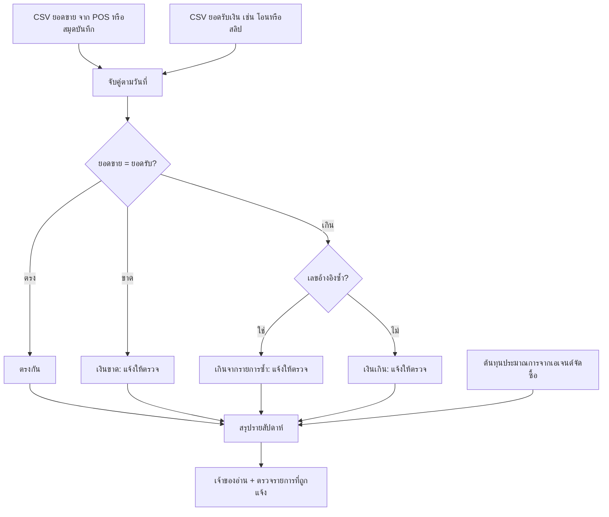

# 03 · เอเจนต์บัญชีและรายงาน (Accounting & Reporting Agent)

**หน้าที่:** ตรวจว่าเงินที่รับเข้ามาจริงตรงกับยอดขายไหม หาวันที่ยอดไม่ตรงหรือรายการซ้ำ และสรุปรายสัปดาห์พร้อมต้นทุนจากเอเจนต์จัดซื้อ

**รอบการทำงาน:** กระทบยอดทุกวัน และสรุปทุกสัปดาห์ · **สถานะ:** ต้นแบบเวอร์ชันเล็ก

## Workflow

## ตัวอย่างผลลัพธ์ (ข้อมูลตัวอย่าง: โรงแรมขนาดเล็ก 10 วัน)

| | จำนวน |
|---|---|
| ยอดขายรวม | 267,400 บาท |
| ยอดรับเงินรวม | 266,000 บาท |
| วันที่ไม่ตรง | 2 วัน: วันหนึ่ง **ขาด 5,600** และอีกวัน **เกิน 4,200** จากเลขอ้างอิงซ้ำ |

ข้อมูลชุดนี้ใส่ความผิดปกติไว้โดยตั้งใจ เพื่อทดสอบว่าระบบจับได้

## ยังไม่ได้ทำ

อ่านสลิปจากรูปด้วย LLM · ส่งสรุปเข้า LINE · เชื่อมบัญชีธนาคาร · ปิดงวดบัญชี (ระบบนี้ไม่ได้แทนนักบัญชี)

กลับ: [README](../README.md)
