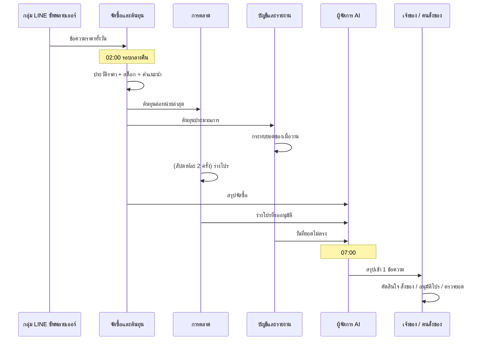

# 04 · ผู้จัดการ AI (Manager / Orchestrator)

**หน้าที่:** รวมผลจากทุกเอเจนต์ที่ธุรกิจเปิดใช้ ให้เจ้าของอ่านจบในข้อความเดียว และส่งข้อมูลต่อระหว่างเอเจนต์

## ลำดับการทำงานใน 1 วัน

## กติกา

- เปิดใช้เอเจนต์เดียวก็ได้ ผู้จัดการจะสรุปเฉพาะเอเจนต์ที่เปิดอยู่
- เอเจนต์ที่ปิดไว้จะไม่ทำงานและไม่ถูกเรียก (ต้นแบบบล็อกด้วย HTTP 403)
- ต้นแบบสรุปด้วยกฎ ในระบบจริงตั้งใจให้ LLM (Sonnet) ช่วยเรียบเรียง

กลับ: [README](../README.md)
