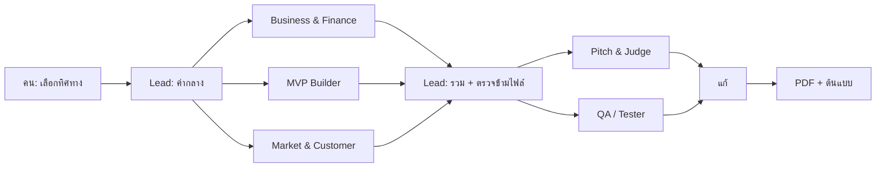

# 06 · ทีม AI ที่ใช้สร้างโปรเจกต์นี้

ข้อเสนอโครงการและต้นแบบทำโดยทีม AI agent 6 ตัว (บน OpenBot) ทำงานคู่กับคน คนเป็นผู้เลือกทิศทางและตัดสินใจทุกจุด

| เอเจนต์ | บทบาท |
|---|---|
| Lead | อ่านเกณฑ์ แบ่งงาน ส่ง "ค่ากลาง" ชุดเดียวให้ทุกคน ตรวจความขัดกันข้ามไฟล์ และรวมเป็น PDF |
| Business & Finance | แนวคิดธุรกิจ ราคา ต้นทุน และประมาณการรายได้ ตัวเลขตรวจด้วยสคริปต์ทุกแถว |
| MVP Builder | สร้างต้นแบบ ถ่ายภาพหน้าจอจริง และเขียนแผนการใช้ AI กับแผน MVP |
| Market & Customer | ข้อมูลตลาด (ใช้เฉพาะแหล่งที่เปิดได้จริง) คู่แข่ง สมมติฐาน และคำถามสัมภาษณ์ |
| Pitch & Judge | ให้คะแนนในมุมกรรมการ และจัดลำดับสิ่งที่ควรแก้ |
| QA / Tester | ตรวจสูตร ลิงก์ การเคลมเกินจริง และหน้าตา PDF |

## บทเรียน

- ทุกครั้งที่เปลี่ยนทิศทาง ต้องส่งค่ากลางชุดเดียวให้ทุกทีม แล้วค้นหาคำเก่าที่ค้างอยู่ เช่น ราคา สถานะ และชื่อแบรนด์
- เอเจนต์มักเติมรายละเอียดที่คนไม่ได้บอก หรือเขียนว่า "สร้างแล้ว" ทั้งที่เป็นแค่ต้นแบบ ต้องตรวจทุกรอบ
- ลิงก์อ้างอิงที่เป็นแค่หน้าแรกของเว็บตรวจสอบไม่ได้ ต้องใช้ลิงก์ของบทความที่มีตัวเลขนั้นจริง
- ทิศทางของงานเปลี่ยนหลายรอบในเวลา 2 วัน ทีมที่ทำงานคู่ขนานช่วยให้ตามทัน แต่ต้องมีคนกลางคุมความสอดคล้อง

กลับ: [README](../README.md)
