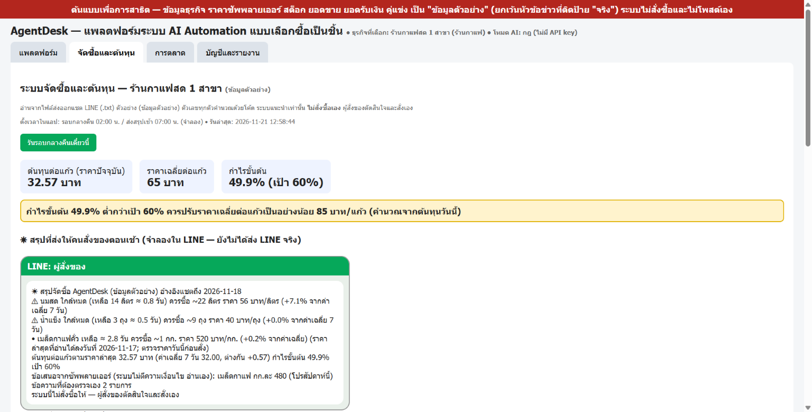

# 07 · คู่มือใช้งานจริง 3 ธุรกิจ (Playbooks)

ไฟล์นี้ไม่ได้เล่าไอเดีย แต่บอก **ทีละขั้น** ว่าธุรกิจจริงต้องเตรียมอะไร ใครทำอะไรตอนไหน ระบบตอบอะไรกลับมา เจ้าของต้องตัดสินใจอะไร และวัดผลอย่างไรใน 2 สัปดาห์

> ผลลัพธ์ทุกกล่องในไฟล์นี้มาจาก **การรันต้นแบบจริง** ด้วย **ข้อมูลตัวอย่าง** (ราคา สต็อก ยอดขาย ไม่ใช่ของร้านจริง) ต้นแบบยังไม่ได้ต่อ LINE จริง และยังรันในโหมดกฎ (ยังไม่ได้ใช้ LLM)
> ถ้าอยากเริ่มพรุ่งนี้โดยไม่ต้องรอแพลตฟอร์ม ข้ามไปที่ [เริ่มพรุ่งนี้แบบทำมือ](#เริ่มพรุ่งนี้แบบทำมือ-ไม่ต้องมีแพลตฟอร์ม)

---

## สิ่งที่ทุกธุรกิจต้องเตรียม (วันที่ 0 · ประมาณ 1–2 ชม.)

| # | สิ่งที่ต้องมี | ทำอย่างไร | ใครทำ |
|---|---|---|---|
| 1 | กลุ่ม LINE ที่ซัพพลายเออร์แจ้งราคา | ใช้กลุ่มเดิมได้เลย ไม่ต้องสร้างใหม่ | เจ้าของ |
| 2 | ความยินยอมจากสมาชิกในกลุ่ม | แจ้งในกลุ่มว่า "ร้านจะใช้ระบบช่วยอ่านราคา เก็บข้อความ 90 วัน ไม่ส่งต่อบุคคลอื่น" (PDPA) | เจ้าของ |
| 3 | รายการของที่ซื้อประจำ 5–15 รายการ | ชื่อ · หน่วยที่ซื้อ (กก./ลิตร/ชิ้น) · ชื่อเรียกอื่นที่ซัพพลายเออร์ใช้ | คนสั่งของ |
| 4 | สูตรใช้ต่อหน่วยขาย | เช่น นมสด 0.15 ลิตรต่อแก้ว หรือหมู 0.12 กก.ต่อหัว | เจ้าของ + ครัว |
| 5 | สต็อกตั้งต้น | นับของจริง 1 ครั้งในวันเริ่ม | คนสั่งของ |
| 6 | ราคาขาย · เป้ากำไร · ขั้นต่ำที่ยอมได้ | เช่น เป้า 60% และขั้นต่ำ 50% | เจ้าของ |
| 7 | (ถ้าใช้ระบบบัญชี) ยอดขายรายวัน + ยอดรับเงิน | ส่งออก CSV จาก POS หรือจดลงชีตตามรูปแบบใน [`examples/coffee`](../examples/coffee/) | แคชเชียร์ |

ข้อมูลทั้ง 7 ข้อจะอยู่ในไฟล์ **โปรไฟล์ธุรกิจ** 1 ไฟล์ ดูตัวอย่างที่รันได้จริงที่ [`examples/coffee/profile.json`](../examples/coffee/profile.json)

---

## Playbook 1 · ร้านกาแฟสด 1 สาขา (ขายเฉลี่ย 120 แก้ว/วัน)

**ปัญหาที่แก้:** นมสดกับน้ำแข็งเป็นของที่เสียง่ายหรือละลายได้ ซื้อน้อยเกินไปของก็หมดกลางวัน ซื้อมากเกินไปก็ต้องทิ้ง และราคานมขึ้นทีละบาทจนไม่มีใครรู้ว่ากำไรต่อแก้วลดลงไปเท่าไร

### ตารางหนึ่งวัน
| เวลา | ใคร / อะไร | เกิดอะไรขึ้น |
|---|---|---|
| ทั้งวัน | ซัพพลายเออร์ 4 เจ้า | แจ้งราคาในกลุ่ม LINE ตามปกติ (ฟาร์มนม · โรงคั่ว · ร้านแพ็กเกจจิ้ง · น้ำแข็ง) |
| 21:00 | พนักงานปิดร้าน | อัปเดตสต็อกนมสด น้ำแข็ง และเมล็ดกาแฟ (3 ตัวเลข ใช้เวลาไม่เกิน 2 นาที) |
| 02:00 | เอเจนต์จัดซื้อ | อ่านข้อความทั้งวัน → อัปเดตประวัติราคา → เทียบกับค่าเฉลี่ย 7 วัน → คำนวณว่าของเหลือพอใช้กี่วัน |
| 07:00 | ผู้จัดการ AI | ส่งสรุปเช้าให้คนสั่งของทาง LINE |
| 07:05 | คนสั่งของ | อ่านสรุป 1 นาที แล้วสั่งของในกลุ่มเองตามปกติ |
| อังคาร/ศุกร์ | เอเจนต์การตลาด | ร่างโปรที่ไม่ขาดทุน รอเจ้าของอนุมัติ |
| ทุกวัน | เอเจนต์บัญชี | เทียบยอดขายกับเงินที่รับเข้าจริง |

### สิ่งที่ระบบตอบกลับ (รันจริงด้วยข้อมูลตัวอย่าง 7 วัน · 30 ข้อความ · อ่านได้ 34 ราคา)



```
☀ สรุปจัดซื้อ (ข้อมูลตัวอย่าง) อ้างอิงแชตถึง 2026-11-18
⚠ นมสด ใกล้หมด (เหลือ 14 ลิตร ≈ 0.8 วัน) ควรซื้อ ~22 ลิตร ราคา 56 บาท/ลิตร (+7.1% จากค่าเฉลี่ย 7 วัน)
⚠ น้ำแข็ง ใกล้หมด (เหลือ 3 ถุง ≈ 0.5 วัน) ควรซื้อ ~9 ถุง
• เมล็ดกาแฟคั่ว เหลือ ≈ 2.8 วัน ควรซื้อ ~1 กก. (ราคาล่าสุดที่อ่านได้ลงวันที่ 17; ตรวจราคาวันนี้ก่อนสั่ง)
ต้นทุนต่อแก้ว 32.57 บาท (ค่าเฉลี่ย 7 วัน 32.00) · กำไรขั้นต้น 49.9% เป้า 60%
ข้อเสนอจากซัพพลายเออร์ (ระบบไม่ตีความเงื่อนไข อ่านเอง): เมล็ดกาแฟ กก.ละ 480 (โปรสัปดาห์นี้)
ข้อความที่ต้องตรวจเอง 2 รายการ: "ไซรัปคาราเมล 95 ค่ะ", "นมข้น 28" (ไม่มีหน่วย)
```

### เจ้าของต้องตัดสินใจอะไรจากสรุปนี้
1. **นมสดแพงขึ้น 7.1% แต่ของจะหมดพรุ่งนี้** ต้องซื้อวันนี้ อาจซื้อแค่พอใช้ 1–2 วันแล้วรอดูราคา
2. **เมล็ดกาแฟมีโปร 480 บาท** (ถูกกว่าค่าเฉลี่ยประมาณ 7.5%) ระบบไม่ตีความโปรแทน คนต้องอ่านเงื่อนไขเอง ถ้าเงื่อนไขโอเค ควรซื้อตุนเพิ่ม
3. **กำไรต่อแก้ว 49.9% ต่ำกว่าเป้า 60%** ระบบคำนวณว่าถ้าต้นทุนเท่านี้ ราคาเฉลี่ยต้องอยู่ที่ประมาณ 85 บาท/แก้ว ถึงจะได้ตามเป้า ทางเลือกคือขึ้นราคาเมนูนม ลดขนาด หรือดันเมนูที่กำไรดีกว่า

### เอเจนต์การตลาดตอบอะไร (รันจริง)
- คู่แข่งจัด "อเมริกาโน่ 45 บาท" → **ไม่แนะนำให้ตามราคา** เพราะที่ 45 บาท กำไรจะเหลือ 27.6% ต่ำกว่าขั้นต่ำ 50% ราคาต่ำสุดที่ยอมได้คือ 66 บาท
- คู่แข่งจัด "แก้วที่ 2 ลด 20%" → **ไม่แนะนำ** เพราะกำไรเหลือ 37.4%
- ระบบดึงหัวข้อข่าววงการกาแฟและเครื่องดื่มจริงมาให้ พร้อมลิงก์ เพื่อใช้เป็นไอเดียโพสต์ คนต้องอ่านเองก่อนใช้

### เอเจนต์บัญชีจับได้ (รันจริง)
| วันที่ | ยอดขาย | รับจริง | ผล |
|---|---|---|---|
| 14 พ.ย. | 6,175 | 5,525 | **เงินขาด 650** ต้องตรวจลิ้นชักเงินสด |
| 17 พ.ย. | 8,060 | 12,090 | **เงินเกิน 4,030** เพราะเลขอ้างอิงซ้ำ น่าจะบันทึกการโอนซ้ำ |

ทั้ง 2 จุดนี้ใส่ไว้ในข้อมูลตัวอย่างเพื่อทดสอบว่าระบบจับได้

---

## Playbook 2 · ร้านชาบูบุฟเฟต์ (ที่มาของโปรเจกต์)

**ปัญหาที่แก้ (จากประสบการณ์ตรงของสมาชิกทีม):** ซัพพลายเออร์แจ้งราคาขึ้นลงและรับคำสั่งซื้อในกลุ่ม LINE เดียว คนสั่งของต้องอ่านแชตเอง ดูของที่มี แล้วตัดสินใจเองทุกวัน

| เวลา | เกิดอะไรขึ้น |
|---|---|
| ระหว่างวัน | ซัพพลายเออร์เนื้อ หมู อาหารทะเล และผัก แจ้งราคาในกลุ่ม |
| หลังปิดร้าน | ครัวอัปเดตสต็อกเนื้อสัตว์ (กก.) |
| 02:00 → 07:00 | เอเจนต์จัดซื้ออ่าน → คำนวณ → ส่งสรุปเช้า |

**ผลที่รันจริง (ข้อมูลตัวอย่าง)**
```
✓ ควรซื้อ หมูสามชั้นสไลด์ ~27 กก. วันนี้ 178 บาท ต่ำกว่าค่าเฉลี่ย 7 วัน 4.1% (ซื้อให้พอ 5 วัน เพราะราคาต่ำ)
⏸ รอก่อน เนื้อวัวสไลด์ 360 บาท สูงกว่าค่าเฉลี่ย 6.8% และกำลังขึ้นต่อเนื่อง · สต็อกยังพอ ≈ 4.6 วัน
⚠ กุ้ง / ปลาหมึก ใกล้หมด
ต้นทุนต่อหัว 104.84 บาท · กำไรขั้นต้น 64.9% (เป้า 60%)
ข้อความที่ต้องตรวจเอง: "ปลาหมึกวันนี้ 230 ค่ะ" (ไม่มีหน่วย)
```

**สิ่งที่เปลี่ยนในการทำงาน:** คนสั่งของไม่ต้องไล่อ่านแชตทั้งวัน เพราะเห็นทันทีว่าวันนี้ควรซื้อหมูตุน และชะลอการซื้อเนื้อ และรู้ด้วยว่าการตัดสินใจนี้ทำให้ต้นทุนต่อหัวเปลี่ยนไปเท่าไร

---

## Playbook 3 · โรงแรมขนาดเล็ก (ขายเฉลี่ย 28 ห้อง-คืน/วัน)

**ปัญหาที่แก้:** ของใช้ในห้องพักและอาหารเช้าซื้อจากหลายเจ้า ยอดเข้าพักวันเสาร์มากกว่าวันอังคารเกือบ 3 เท่า ถ้าซื้อเท่ากันทุกวันจะมีของเหลือ และเงินที่รับหลายช่องทาง (โอน เงินสด บัตร) ตรวจด้วยมือยาก

**ผลที่รันจริง (ข้อมูลตัวอย่าง)**
```
ซื้อ น้ำดื่ม ~186 ขวด · ผลไม้รวมถูกลง 7.1% ควรซื้อ ~4 กก.
⏸ รอก่อน ไข่ไก่ (+10.4%) และค่าซักรีด (+8.1%)
ต้นทุน 382.40 บาท/ห้อง-คืน · กำไร 72.7% (เป้า 70%)
ข้อความที่ต้องตรวจเอง: "นมกล่อง 9 ค่ะ" (ไม่มีหน่วย)
บัญชี 10 วัน: ยอดขาย 267,400 / รับจริง 266,000 → ไม่ตรง 2 วัน (ขาด 5,600 · เกิน 4,200 จากเลขอ้างอิงซ้ำ)
```

**เจ้าของตัดสินใจ:** ชะลอการซื้อไข่ไก่ถ้าสต็อกยังพอถึงวันศุกร์ ส่งพนักงานไปตรวจยอดของ 2 วันที่ไม่ตรง และเอเจนต์การตลาดจะไม่เสนอโปรที่ใช้อาหารเช้าเป็นจุดขายในสัปดาห์ที่ไข่แพง

---

## วัดผลใน 2 สัปดาห์ (ใช้ได้กับทุกธุรกิจ)

| สัปดาห์ | ทำอะไร |
|---|---|
| 1 (ฐาน) | ใช้วิธีเดิม แต่ **จด 4 ตัวเลขทุกวัน**: นาทีที่ใช้อ่านแชตและตัดสินใจ · ของที่ทิ้ง (กก./ลิตร) · ครั้งที่ของหมดระหว่างวัน · ราคาที่ซื้อจริง |
| 2 (ทดลอง) | ใช้สรุปเช้าของระบบ แล้วจด 4 ตัวเลขเดิม + ระบุว่าวันนั้นทำตามคำแนะนำหรือไม่ |

| ตัวชี้วัด | วิธีคิด | ผ่านเมื่อ (ตั้งเป้าเอง) |
|---|---|---|
| เวลาที่ประหยัดได้ | นาที/วัน สัปดาห์ 1 − สัปดาห์ 2 | ลดลงอย่างเห็นได้ชัด |
| ของเสีย | กก. ที่ทิ้ง สัปดาห์ 1 เทียบสัปดาห์ 2 | ลดลง |
| ของขาด | จำนวนครั้งที่ของหมด | ไม่เพิ่มขึ้น |
| ซื้อถูกจังหวะ | ราคาที่ซื้อจริงเทียบค่าเฉลี่ย 7 วัน | ต่ำกว่าค่าเฉลี่ยบ่อยขึ้น |
| ความแม่นของการอ่าน | ราคาที่ระบบอ่านถูก ÷ ราคาทั้งหมด | ≥ 90% |

> ยังไม่มีผลจากร้านจริง ตัวเลขเป้าต้องตั้งหลังได้ค่าฐานจากสัปดาห์ที่ 1

### คิดความคุ้มค่าเองได้ (สูตร + ตัวอย่างตัวเลขสมมติ)
```
เงินที่ประหยัดต่อเดือน ≈ (ปริมาณที่ซื้อต่อเดือน × ส่วนต่างราคาที่เลี่ยงได้) + มูลค่าของเสียที่ลดลง
ตัวอย่าง (สมมติ): นมสด 18 ลิตร/วัน × 30 วัน = 540 ลิตร
  ถ้าเลี่ยงวันที่แพงได้เฉลี่ย 1.5 บาท/ลิตร → 810 บาท
  + นมทิ้งลดลง 0.5 ลิตร/วัน × 52 บาท × 30 วัน → 780 บาท
  รวม ≈ 1,590 บาท/เดือน เทียบค่าระบบจัดซื้อ 690 บาท/เดือน
```
ร้านควรแทนตัวเลขด้วยค่าที่วัดได้จากสัปดาห์ที่ 1–2 ของตัวเอง

---

## เริ่มพรุ่งนี้แบบทำมือ (ไม่ต้องมีแพลตฟอร์ม)

ทำ workflow เดียวกันได้ด้วยของที่มีอยู่แล้ว เพื่อทดสอบว่าคุ้มก่อนลงทุน

1. **ส่งออกแชต:** ในกลุ่ม LINE ไปที่ ☰ → การตั้งค่า → ส่งออกประวัติแชต (.txt)
2. **ทำ Google Sheets 2 แท็บ:**
   - `สินค้า`: ชื่อ · หน่วย · ใช้ต่อหน่วยขาย · สต็อกวันนี้
   - `ราคา`: วันที่ · สินค้า · ราคา (วางผลจากข้อ 3)
3. **ให้ AI ช่วยอ่านแชต** (Claude หรือ ChatGPT) ด้วย prompt นี้

```
นี่คือแชตกลุ่มซัพพลายเออร์ของร้าน และรายการสินค้าของร้าน
1) ดึงทุกราคาออกมาเป็นตาราง: วันที่ | สินค้า (ใช้ชื่อในรายการ) | หน่วย | ราคา | ผู้ขาย
2) ถ้าข้อความไหนไม่มีหน่วยหรือไม่ชัด ห้ามเดา ให้แยกไว้ในตาราง "ต้องตรวจ"
3) ข้อความโปรโมชันให้คัดลอกข้อความเดิมไว้ในตาราง "โปร" ไม่ต้องตีความ
ห้ามคำนวณตัวเลขอื่น ทำแค่ดึงข้อมูล
[วางรายการสินค้า]
[วางแชต]
```

4. **ให้ชีตคำนวณ** (ไม่ให้ AI คิดเลข):
   - ค่าเฉลี่ย 7 วัน `=AVERAGEIFS(ราคา!C:C, ราคา!B:B, A2, ราคา!A:A, ">="&TODAY()-6)`
   - ต่างจากค่าเฉลี่ย % `=(ราคาวันนี้-ค่าเฉลี่ย)/ค่าเฉลี่ย`
   - พอใช้กี่วัน `=สต็อก/(ใช้ต่อหน่วย*ยอดขายต่อวัน)`
   - ต้นทุนต่อหน่วย `=SUMPRODUCT(ราคาล่าสุด, ใช้ต่อหน่วย) + ต้นทุนคงที่`
5. **กฎตัดสินใจ:** พอใช้น้อยกว่า 1 วัน = ซื้อ · ราคาต่ำกว่าค่าเฉลี่ย 3% และของไม่เสียง่าย = ซื้อตุน · ราคาสูงกว่าค่าเฉลี่ย 3%, กำลังขึ้น และสต็อกยังพอ = รอ

แบบทำมือใช้เวลาประมาณ 10 นาทีต่อวัน AgentDesk ทำขั้นตอน 1–5 ให้อัตโนมัติทุกคืน

---

## เพิ่มธุรกิจของคุณเอง

1. คัดลอก [`examples/coffee/profile.json`](../examples/coffee/profile.json) แล้วแก้ชื่อ หน่วย รายการสินค้า สูตร และเป้ากำไร
2. ใส่ชื่อเรียกอื่นที่ซัพพลายเออร์ใช้ใน `aliases` เช่น "นม", "นมสด" หรือ "นมจืด"
3. รันกับแชต 1 สัปดาห์ แล้วดูตาราง "ต้องตรวจ" ถ้าเจอคำที่ระบบอ่านไม่ได้บ่อย ให้เพิ่มเป็น alias

**ใช้ได้ดีกับ:** ธุรกิจที่ซื้อของซ้ำจากผู้ขายหลายเจ้า ราคาเปลี่ยนบ่อย และมีหน่วยขายชัดเจน เช่น ร้านอาหาร คาเฟ่ เบเกอรี่ โรงแรม ร้านวัสดุ หรือร้านดอกไม้
**ยังใช้ไม่ได้ดี:** ธุรกิจที่ต้นทุนคิดต่องานหรือต่อชิ้นแบบไม่ซ้ำ เช่น อู่ซ่อมรถหรืองานรับเหมา ต้องเพิ่มสูตรต้นทุนก่อน

กลับ: [README](../README.md)
